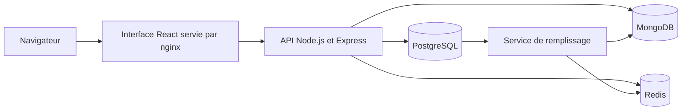
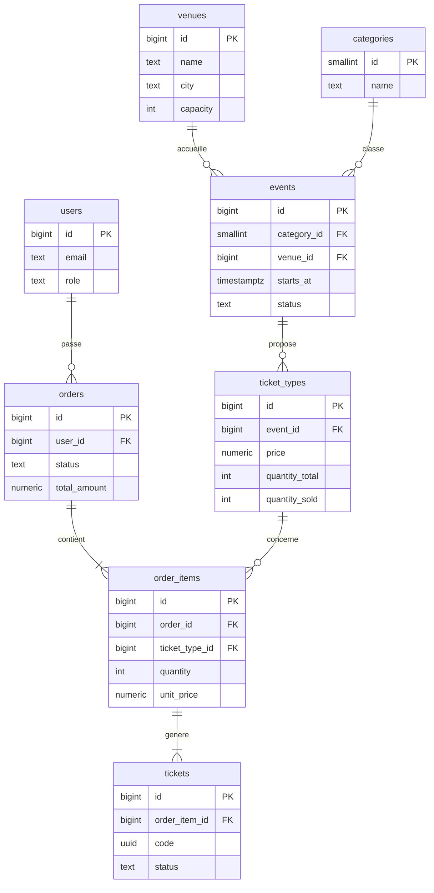

# Billetterie, dossier de présentation

## 1. Le projet

L'application permet de vendre des billets pour des événements : concerts, théâtre, sport, festivals, conférences, danse, humour et expositions. Un client parcourt le catalogue, lit les avis, ajoute des places à son panier, paie et reçoit ses billets. Un administrateur gère les événements et suit les ventes.

J'ai choisi ce sujet parce qu'il mélange trois types de données très différents :

| Type de donnée | Exemple | Ce dont on a besoin | Base choisie |
| Argent et stock | commandes, billets, places restantes | fiabilité totale, transactions | PostgreSQL |
| Contenu qui varie | la page d'un concert ne ressemble pas à celle d'un match | souplesse, recherche de texte | MongoDB |
| Données temporaires | panier, cache, classement | rapidité, expiration automatique | Redis |

Au démarrage, les bases sont remplies avec environ 3 000 utilisateurs, 60 salles, 600 événements, 1 800 tarifs, 20 000 commandes, 46 600 billets, 600 pages d'événements et 5 280 avis. Les données sont cohérentes entre les bases : un avis n'existe que si son auteur a réellement assisté à l'événement.

## 2. Architecture



Tout démarre avec une seule commande Docker. PostgreSQL et MongoDB se créent en premier, puis un petit service lit PostgreSQL pour remplir MongoDB et Redis, puis l'API démarre, et enfin l'interface.

Seule l'API écrit dans les bases, avec des comptes qui ont des droits limités.

Quelques routes de l'API utilisent plusieurs bases à la fois :

- La fiche d'un événement regarde d'abord dans le cache Redis. Si elle n'y est pas, l'API lit l'événement et ses tarifs dans PostgreSQL, sa page dans MongoDB, puis garde le résultat en cache pendant 60 secondes.
- Le paiement lit le panier dans Redis, crée la commande dans PostgreSQL, puis vide le panier et met à jour le classement des ventes dans Redis.
- Pour publier un avis, l'API vérifie dans PostgreSQL que la personne avait un billet, puis enregistre l'avis dans MongoDB.
- Une statistique compare la note moyenne des événements, calculée dans MongoDB, à leur chiffre d'affaires, calculé dans PostgreSQL.

## 3. Le modèle relationnel

### Modèle conceptuel

Il y a huit entités : utilisateur, salle, catégorie, événement, type de billet, commande, ligne de commande et billet.

Les règles entre elles :

- une salle accueille zéro ou plusieurs événements, un événement a lieu dans une seule salle
- une catégorie regroupe zéro ou plusieurs événements, un événement a une seule catégorie
- un événement propose zéro ou plusieurs types de billets, un type de billet appartient à un seul événement
- un utilisateur passe zéro ou plusieurs commandes, une commande appartient à un seul utilisateur
- une commande contient au moins une ligne, une ligne appartient à une seule commande
- un type de billet peut apparaître dans plusieurs lignes, une ligne porte sur un seul type de billet
- une ligne génère au moins un billet, un billet vient d'une seule ligne

Le lien entre commande et type de billet est un lien plusieurs à plusieurs qui porte des informations, la quantité et le prix. Il devient donc l'entité ligne de commande. Le prix y est recopié au moment de l'achat, pour que les anciennes commandes gardent le prix réellement payé si le tarif change.

### Modèle logique



Le modèle respecte la troisième forme normale. Deux informations sont volontairement stockées en double. Le nombre de places vendues par tarif évite de recompter les billets à chaque affichage. Le montant total de la commande est calculé une seule fois, au paiement.

### Modèle physique

Le script complet est dans [docker/init-sql/01_schema.sql]   (../docker/init-sql/01_schema.sql). Voici les choix principaux.

- Les montants utilisent un type décimal exact, pour éviter les erreurs d'arrondi.
- Les dates sont stockées avec leur fuseau horaire.
- Chaque billet a un code unique aléatoire, impossible à deviner, qui sert de QR code.
- Des contraintes de vérification protègent les données : on ne peut jamais vendre plus de places qu'il n'y en a, un événement se termine forcément après avoir commencé, une commande payée a forcément une date de paiement, et un e-mail est toujours en minuscules.
- Des contraintes d'unicité empêchent les doublons : deux salles du même nom dans la même ville, deux tarifs du même nom pour un événement.
- On ne peut pas supprimer une salle qui a des événements, ni un tarif déjà vendu. En revanche, supprimer une commande supprime ses lignes et ses billets.

Une partie de la logique est directement dans la base :

- Une fonction passe une commande complète en une seule transaction : elle crée la commande, ses lignes et ses billets. Si une seule étape échoue, rien n'est enregistré.
- Un déclencheur met à jour le stock à chaque achat. La mise à jour ne réussit que s'il reste assez de places, donc deux clients qui achètent la dernière place en même temps ne peuvent pas l'obtenir tous les deux.
- Un autre déclencheur remet les places en vente quand une commande est annulée.
- Deux vues préparent le catalogue public et le bilan des ventes par événement.

## 4. Le modèle NoSQL

### MongoDB, les pages d'événements

Chaque événement a un document qui contient tout ce qui sert à le présenter. Il est relié à PostgreSQL par le numéro de l'événement.

Voici la page d'un concert :

```json
{
  "event_id": 32,
  "title": "Les Ombres Bleues en concert",
  "category": "concert",
  "description": "Une création originale saluée par la critique.",
  "tags": ["pop", "soirée", "rock"],
  "lineup": [
    { "name": "Les Ombres Bleues", "role": "tête d'affiche", "genre": "chanson française" }
  ],
  "set_duration_min": 105,
  "practical": { "age_min": 18, "accessibility": ["fauteuil roulant"] }
}
```

Chaque page contient aussi sa note moyenne et son nombre d'avis, recalculés à partir de la collection des avis.

La page d'un match est dans la même collection, mais elle a une liste d'équipes et une compétition au lieu d'une liste d'artistes. Une pièce de théâtre a un metteur en scène et une distribution, une conférence a des intervenants. En relationnel, il aurait fallu une table par catégorie ou une table remplie de cases vides.

Cette souplesse reste encadrée. MongoDB vérifie à chaque écriture que les champs communs sont présents et valides : numéro d'événement, titre, catégorie dans une liste fermée, description et note entre 0 et 5.

### MongoDB, les avis

Les avis sont dans une collection séparée. Chaque avis contient le numéro de l'événement, celui de l'auteur, son nom d'affichage, une note de 1 à 5, un commentaire, des notes détaillées sur le son, l'ambiance et l'organisation, et le nombre de votes utiles.

Je ne les ai pas mis à l'intérieur de la page de l'événement, parce que leur nombre n'a pas de limite et qu'un document MongoDB ne peut pas dépasser 16 Mo. Les avis sont aussi lus page par page et analysés à part. À l'inverse, la liste des artistes et les infos pratiques sont toujours lues avec la page et restent petites : elles sont donc rangées dans le document.

Les index MongoDB servent à :

- garantir une seule page par événement
- garantir un seul avis par personne et par événement
- filtrer le catalogue par catégorie et par mot clé
- retrouver les concerts d'un artiste
- faire une recherche de texte en français, où le titre compte plus que la description
- afficher les avis d'un événement du plus récent au plus ancien

### Redis

| Donnée | Type Redis | Durée de vie |
| Fiche d'un événement en cache | texte | 60 secondes |
| Panier d'un utilisateur | table de hachage | 15 minutes |
| Classement des ventes | ensemble trié | permanent |
| Nombre de vues par événement | ensemble trié | permanent |
| Personnes ayant voté pour un avis | ensemble | permanent |

## 5. Pourquoi ces choix

PostgreSQL gère tout ce qui touche à l'argent et aux places. Une vente doit réussir entièrement ou pas du tout, et deux achats simultanés ne doivent jamais vendre la même place. Les clés étrangères et les contraintes garantissent ces règles dans la base elle-même, donc même une erreur dans le code de l'API ne peut pas les contourner.

MongoDB convient aux pages d'événements parce que leur structure change selon la catégorie, qu'elles se lisent d'un seul bloc sans jointure, et que MongoDB sait faire une recherche de texte en français. Ses pipelines d'agrégation servent aussi à analyser les avis.

Redis garde ce qui est temporaire ou demandé très souvent. Un panier abandonné disparaît tout seul après 15 minutes. Le classement des ventes reste trié en permanence, ce qui évite de recalculer 25 000 lignes de commande à chaque visite de la page d'accueil. Si Redis est vidé, rien d'important n'est perdu : le cache se reconstruit et le classement se recalcule depuis PostgreSQL.

Mettre tout dans PostgreSQL aurait obligé à ranger les pages dans un champ JSON, en perdant la validation et les outils d'analyse de MongoDB. Mettre tout dans MongoDB aurait obligé à recoder à la main les règles de stock et les liens entre les tables.

Pour garder les bases cohérentes entre elles, PostgreSQL fait toujours foi pour les ventes. À la création d'un événement, la page MongoDB est enregistrée pendant la transaction PostgreSQL : si MongoDB échoue, PostgreSQL annule tout. À la suppression, PostgreSQL passe en premier et refuse si des billets ont été vendus, puis MongoDB et Redis sont nettoyés.

## 6. Requêtes significatives

Les requêtes complètes et expliquées sont dans [docs/sql/advanced_queries.sql](sql/advanced_queries.sql) et [docs/nosql/mongo_queries.js](nosql/mongo_queries.js). Le README explique comment les lancer.

### Performances par catégorie

But : comparer les catégories, en ne gardant que celles qui ont assez de commandes pour être significatives. La requête regroupe les ventes par catégorie, calcule plusieurs totaux selon le statut de la commande, puis filtre les groupes trop petits.

| Catégorie | Commandes | Billets vendus | Chiffre d'affaires | Taux d'annulation |

| Festival | 2 671 | 5 511 | 665 419 € | 11,2 % |
| Humour | 3 406 | 7 117 | 484 777 € | 10,9 % |
| Sport | 2 411 | 5 182 | 436 433 € | 8,6 % |
| Concert | 1 797 | 3 892 | 274 934 € | 6,8 % |

Les festivals rapportent le plus, mais ce sont aussi eux qui sont le plus souvent annulés.

### Meilleurs clients

But : préparer un programme de fidélité. La requête classe les clients selon le montant dépensé et, pour chacun, retrouve sa catégorie préférée grâce à une sous-requête.

| Rang | Client | Commandes | Total dépensé | Catégorie préférée |

| 1 | Raphaël Richard | 10 | 3 638 € | Sport |
| 2 | Mohamed David | 14 | 3 598 € | Sport |
| 3 | Emma Moreau | 13 | 3 501 € | Festival |

### Clients inactifs

But : relancer les clients qui n'ont jamais rien acheté. La requête garde les comptes pour lesquels il n'existe aucune commande payée. Résultat : 5 clients, soit 0,2 % des comptes.

### Évolution mensuelle

But : suivre le chiffre d'affaires mois par mois et le comparer au mois précédent. Par exemple, mars 2026 fait 247 149 € (+17,5 %), avril 241 145 € (−2,4 %) et mai 207 600 € (−13,9 %).

### Salles sans événement à venir

But : signaler à l'équipe commerciale les salles qui n'ont plus rien de programmé. La requête garde toutes les salles, même celles qui n'ont aucun événement correspondant. Résultat : 8 salles, dont l'Arena de Marseille et ses 11 805 places.

### Analyse des avis dans MongoDB

But : obtenir en une seule requête la répartition des notes et la note moyenne par catégorie. Comme la catégorie est rangée dans la page de l'événement, la requête va la chercher dans l'autre collection.

Sur 5 280 avis, on compte 3 notes de 1, 636 notes de 2, 1 709 notes de 3, 1 959 notes de 4 et 973 notes de 5. Les festivals sont les mieux notés avec 3,72 de moyenne, et les concerts les moins bien notés avec 3,51.

## 7. Index et performances

PostgreSQL crée automatiquement un index sur les clés primaires et les champs uniques, mais pas sur les clés étrangères. J'ai donc ajouté des index sur les colonnes utilisées dans les jointures et les filtres de l'API.

Pour mesurer l'effet d'un index, j'ai pris la requête « Mes commandes », appelée à chaque visite de l'espace client. Elle cherche les commandes d'un client, de la plus récente à la plus ancienne. Le script [docs/sql/explain_index.sql](sql/explain_index.sql) l'exécute sans l'index, puis avec.

| | Méthode de lecture | Temps |

| Sans index | lit les 20 000 commandes une par une | 0,69 ms |
| Avec index | va directement aux 7 commandes du client | 0,09 ms |

La requête est environ 7 fois plus rapide, et l'écart grandit avec le nombre de commandes. L'index porte sur le client et la date à la fois, donc il sert au filtre et au tri en même temps.

Côté MongoDB, la recherche des concerts d'un artiste utilise son index : elle examine 4 documents pour 4 résultats, au lieu de parcourir les 600 pages.

Côté Redis, le cache évite de relire PostgreSQL et MongoDB à chaque visite d'une fiche d'événement.

## 8. Sécurité

- L'API ne se connecte jamais avec le compte administrateur des bases. Dans PostgreSQL, son compte peut lire et écrire les données mais pas modifier la structure, et il ne peut pas supprimer d'utilisateurs ni de salles. Dans MongoDB, son compte peut gérer les documents mais pas supprimer une collection.
- Les mots de passe sont chiffrés avec bcrypt, et la connexion utilise des jetons JWT.
- Toutes les données reçues sont vérifiées avant d'arriver aux bases, et les requêtes SQL sont paramétrées, ce qui empêche les injections.
- Aucun vrai secret n'est dans le dépôt. Les valeurs fournies servent uniquement au développement.

## 9. Stratégie de sauvegarde

| Base | Importance | Méthode | Fréquence |

| PostgreSQL | critique, ce sont les ventes | sauvegarde complète chaque jour, plus l'archivage continu du journal pour revenir à n'importe quel moment | quotidienne et continue |
| MongoDB | importante, les avis ne peuvent pas être recréés | sauvegarde compressée | quotidienne |
| Redis | faible | journal activé, et le classement peut être recalculé depuis PostgreSQL | aucune |

On garde trois copies, sur deux supports différents, dont une hors du serveur. Les sauvegardes sont conservées sept jours, plus une par semaine pendant un mois.

Une sauvegarde ne vaut rien si on ne sait pas la restaurer. J'ai donc testé les commandes ci-dessous en restaurant dans des bases vides : on retrouve bien les 46 613 billets et les 5 280 avis. La sauvegarde PostgreSQL pèse 2,3 Mo et celle de MongoDB 0,2 Mo.

Pour sauvegarder :

```bash
mkdir backups
docker exec billetterie-postgres pg_dump -U postgres -d billetterie -Fc -f /tmp/billetterie.dump
docker cp billetterie-postgres:/tmp/billetterie.dump backups/
docker exec billetterie-mongo mongodump -u root -p mongo_dev_only --authenticationDatabase admin --db billetterie --gzip --archive=/tmp/billetterie-mongo.gz
docker cp billetterie-mongo:/tmp/billetterie-mongo.gz backups/
```

Pour restaurer, on arrête l'API, on recrée la base PostgreSQL vide, puis on recharge les deux sauvegardes :

```bash
docker compose stop api
docker cp backups/billetterie.dump billetterie-postgres:/tmp/
docker exec billetterie-postgres dropdb -U postgres --force billetterie
docker exec billetterie-postgres createdb -U postgres billetterie
docker exec billetterie-postgres pg_restore -U postgres -d billetterie /tmp/billetterie.dump
docker cp backups/billetterie-mongo.gz billetterie-mongo:/tmp/
docker exec billetterie-mongo mongorestore -u root -p mongo_dev_only --authenticationDatabase admin --gzip --archive=/tmp/billetterie-mongo.gz --drop
docker compose start api 